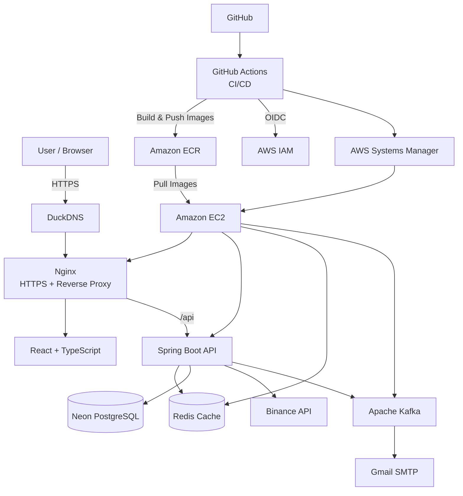
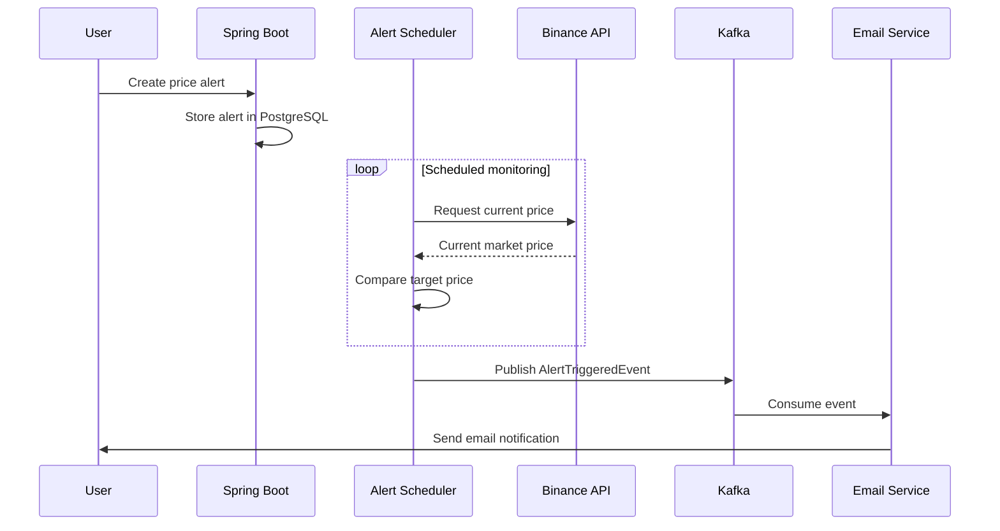
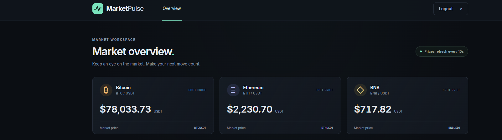
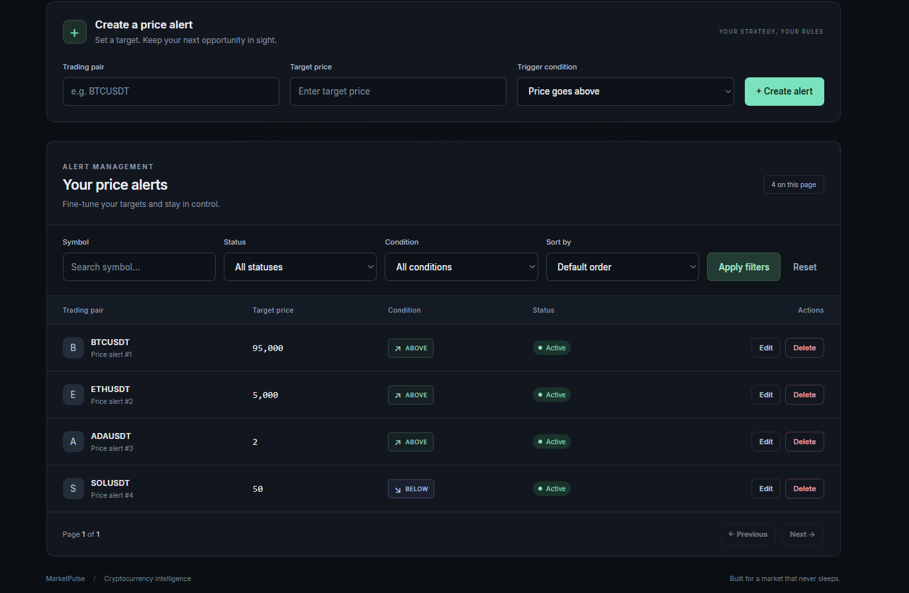
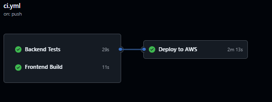

# MarketPulse

MarketPulse is a full-stack cryptocurrency price monitoring and alerting application built as a backend-focused learning and portfolio project.

Users can register, authenticate with JWT, monitor live cryptocurrency prices, and create price alerts that trigger when a target price is reached. Triggered alerts are processed asynchronously through Kafka and can generate email notifications.

🌐 **Live Demo:** https://marketpulse-alp.duckdns.org

---

## Features

- User registration and JWT-based authentication
- Live cryptocurrency prices from Binance
- Redis-based price caching
- Create, update, delete, and view price alerts
- ABOVE / BELOW price conditions
- Automatic price monitoring with scheduled jobs
- Kafka-based asynchronous alert events
- Email notifications for triggered alerts
- Filtering, sorting, and pagination
- Responsive React dashboard
- Spring Boot Actuator health checks
- HTTPS with Let's Encrypt
- Automated CI/CD deployment to AWS

---

## Tech Stack

### Backend

- Java 21
- Spring Boot 4
- Spring Security
- JWT
- Spring Data JPA
- PostgreSQL
- Redis
- Apache Kafka
- Maven
- JUnit
- Mockito
- Testcontainers
- Spring Boot Actuator

### Frontend

- React
- TypeScript
- Vite
- Nginx

### Infrastructure & DevOps

- Docker
- Docker Compose
- GitHub Actions
- Amazon EC2
- Amazon ECR
- AWS IAM
- GitHub OIDC
- AWS Systems Manager (SSM)
- Neon PostgreSQL
- DuckDNS
- Let's Encrypt / Certbot

---

## Architecture



---

## CI/CD Pipeline

Development follows a feature-branch workflow.

Pull requests to `main` automatically run:

- Backend tests
- Frontend lint
- Frontend production build

Deployment is skipped during pull requests.

After a successful merge into `main`, GitHub Actions:

1. Runs backend and frontend checks.
2. Authenticates to AWS using GitHub OIDC.
3. Builds backend and frontend Docker images.
4. Tags images with the Git commit SHA.
5. Pushes the images to Amazon ECR.
6. Sends deployment commands to EC2 through AWS Systems Manager.
7. Pulls the new images on EC2.
8. Restarts the application using Docker Compose.
9. Checks the Spring Boot health endpoint.
10. Verifies the public HTTPS endpoint.

The deployment does not require storing long-lived AWS access keys or an EC2 SSH private key in GitHub.

---

## Alert Flow



---

## API Overview

Main API groups include:

```text
/api/v1/auth
/api/v1/users
/api/v1/market
/api/v1/alerts
/actuator/health
```

Swagger / OpenAPI documentation is available when the application is running.

---

## Local Development

### Requirements

- Java 21
- Docker
- Docker Compose
- Node.js
- npm

Create a local `.env` file with the required environment variables:

```env
MARKETPULSE_DB_USERNAME=
MARKETPULSE_DB_PASSWORD=
JWT_SECRET=
MAIL_USERNAME=
MAIL_APP_PASSWORD=
```

Start PostgreSQL, Redis, Kafka, and the backend:

```bash
docker compose up -d
```

For frontend development:

```bash
cd frontend
npm install
npm run dev
```

The frontend development server runs on:

```text
http://localhost:5173
```

The backend runs on:

```text
http://localhost:8080
```

---

## Production Deployment

The production environment runs on an AWS EC2 instance using Docker Compose.

Production services:

```text
Nginx / React
Spring Boot
Redis
Kafka
```

PostgreSQL is hosted separately on Neon.

Only ports 80 and 443 are exposed publicly. Backend, Redis, and Kafka communicate through the internal Docker network.

HTTP traffic is redirected to HTTPS and TLS certificates are issued and automatically renewed using Let's Encrypt and Certbot.

---

## Security

- Stateless JWT authentication
- BCrypt password hashing
- Environment-based secret configuration
- `.env` files excluded from Git
- HTTPS/TLS
- AWS IAM roles
- GitHub Actions authentication through OIDC
- EC2 deployments through AWS SSM instead of exposing deployment credentials
- Backend services are not directly exposed to the internet

---

## Testing

The project includes:

- Unit tests with JUnit and Mockito
- Integration testing with Testcontainers
- Automated backend tests in GitHub Actions
- Frontend lint and production build validation
- Deployment health verification through Spring Boot Actuator

---

## Screenshots

### Login


### Market Overview



### Price Alerts



### CI/CD Pipeline



---

## Project Purpose

MarketPulse was developed as a learning and portfolio project to gain practical experience building and deploying a modern backend system end-to-end.

The project focuses not only on application development, but also on authentication, caching, asynchronous messaging, testing, containerization, cloud infrastructure, CI/CD, security, monitoring, and production deployment.